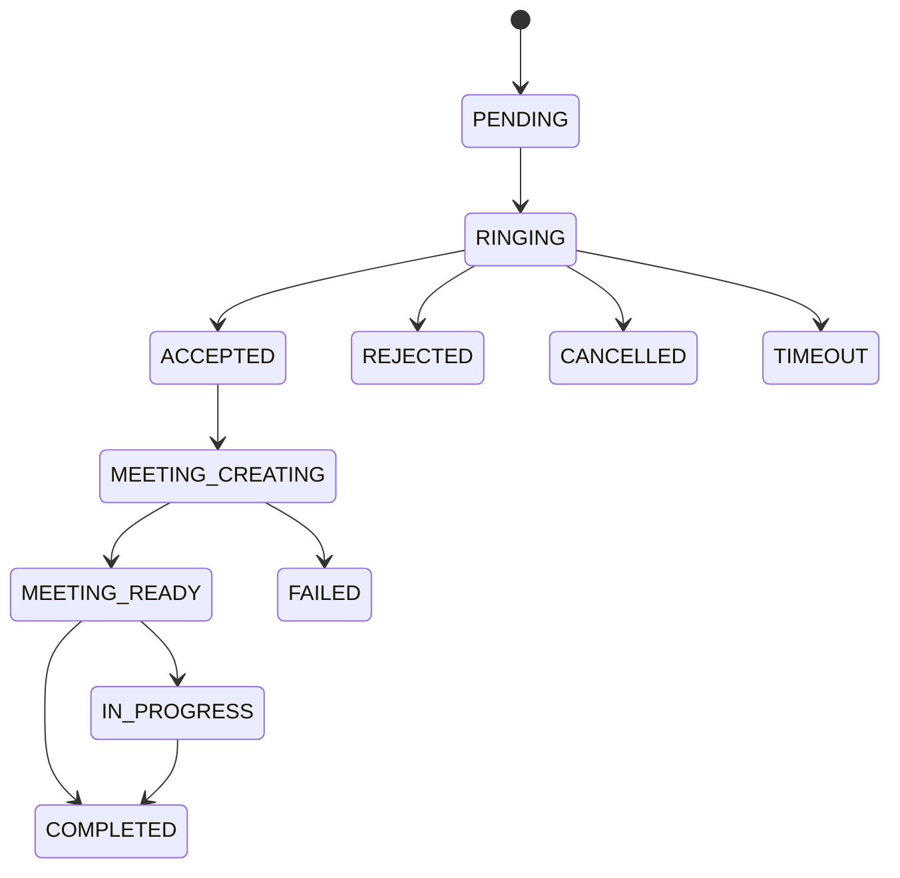

# Trạng thái cuộc gọi — nguồn chuẩn trước khi triển khai

Mọi chuyển trạng thái khác bị từ chối. Tạo/accept thực hiện trong transaction và khóa PostgreSQL theo bác sĩ/bệnh nhân; unique partial indexes bảo vệ thêm active calls. Idempotency-Key bắt buộc khi tạo; accept/join/complete được lặp an toàn. Không retry meeting thật ở giai đoạn mock.

Sau reject/cancel/timeout/complete/failure, bác sĩ về OFFLINE và phải chủ động ONLINE. Heartbeat 10 giây, stale sau 45 giây; ngắt socket đặt OFFLINE nếu không còn kết nối của bác sĩ. Active consultation vẫn BUSY sau disconnect hoặc restart. Worker trong một instance kiểm tra timeout lưu trong DB mỗi giây, kể cả sau restart. Không triển khai Redis adapter/BullMQ trong phase này.
